## 功能新增/调整

### 1. 首次启动引导与本机 Agent 自动发现

新安装或尚未完成初始化的用户，首次启动会进入三步引导：

1. 检查 Git；可以暂时跳过，之后在需要 Git 的操作前再处理。
2. 检查 Node.js、npm、npx；三项均需通过才能继续。
3. 扫描并诊断本机可用 Agent；诊断成功的 Agent 会自动加入「Agent 管理」，再选择默认 Agent、模型和权限模式，预览后应用到全部内置工作流。

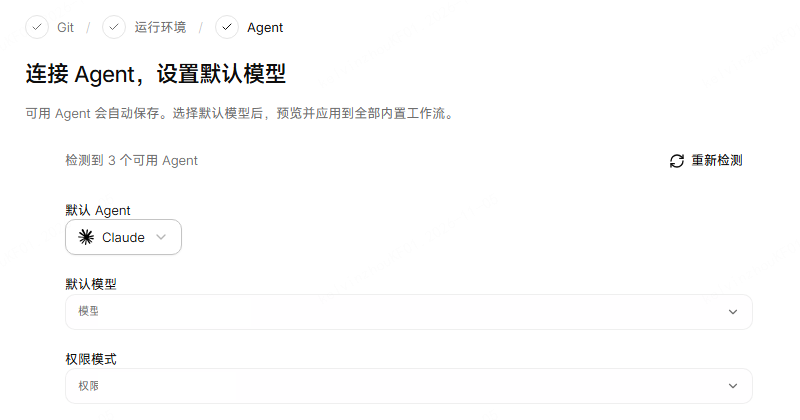

已完成初始化的用户，可以在「设置 → 通用 → 引导与工作流」重新运行引导；其中「配置默认项」只批量调整内置工作流，不会覆盖自定义工作流。

> [!NOTE]
> 引导不会自动安装 Git、Node.js 或 Agent。缺少工具时会提供官方安装指引；安装或登录后重新检测即可。Agent 必须通过本轮诊断，才会列入可选清单。

### 2. Composer 草稿箱与待发送队列

Direct 会话运行中可以继续输入，内容可以先加入待发送队列，再按需要发送。队列最多保留 10 条，支持自动或手动发送、暂停与恢复、调整顺序、编辑、删除和立即发送；停止会话或重启客户端后，未发送内容仍会保留。

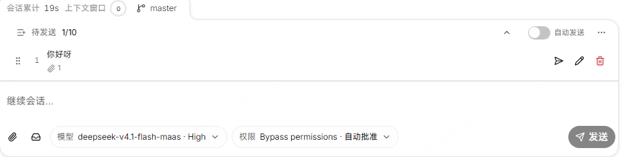

可在「设置 → 高级 → 待发送」开启「立即发送前确认打断当前回复」，避免立即发送时打断当前正在生成的回复。

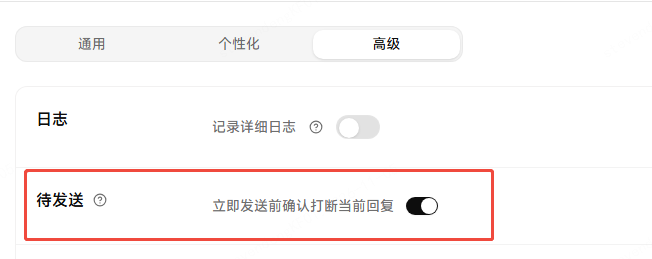

新增草稿箱，最多保存 20 条草稿。草稿会保留正文、文件引用、角色和附件引用，取回到输入框后再决定是否发送。保存失败不会清空正在编辑的内容，附件也不会因为停止会话或切换页面而丢失。

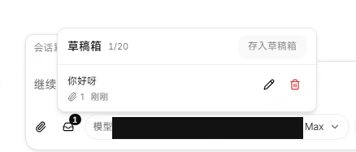

### 3. Multica 需求看板与结果交接

行内版的「需求管理」进一步完善远程任务协作：

1. 可以按开发、测试类型筛选，并按任务名搜索；开发任务完成后，相关测试任务会显示「已就绪」并优先排在待办列表前面，需要创建 DPMS 需求的任务会显示「DPMS」提示。
2. 工作流中被指定的节点可以分阶段回传交付快照，后续任务可在上游未完成时拉取说明；收尾节点最终汇总整个工作项。任务完成后，也可以在原会话继续补充并更新交付说明。
3. 上游交付说明尚未生成时，会话内会显示处理卡片，可以继续等待、手动提供信息或跳过本次拉取。
4. 已完成或失败的任务可以「重新执行」，原记录会移回待办列表，并显示「重新执行」标记。
5. 在 Multica 网页发起角色或工作流共享后，客户端可以在后台接收并刷新对应列表，不需要在桌面端重复导入。

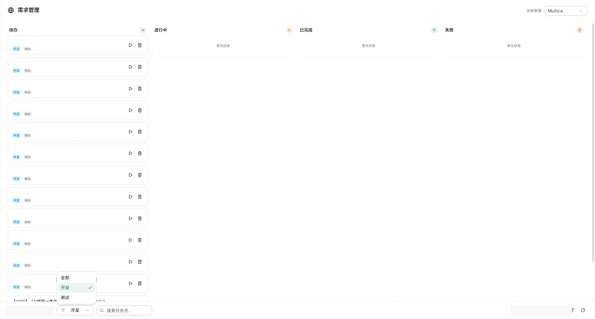

### 4. 角色管理扩展与 WeAPM 内置角色

「上下文管理 → 角色管理」现在支持直接选择一个或多个 Markdown 文件导入，也支持选择文件夹批量导入；每批最多处理 5000 个文件，导入结果会保留每个文件的成功或失败原因。自定义角色列表改为完整展示，不再分页。

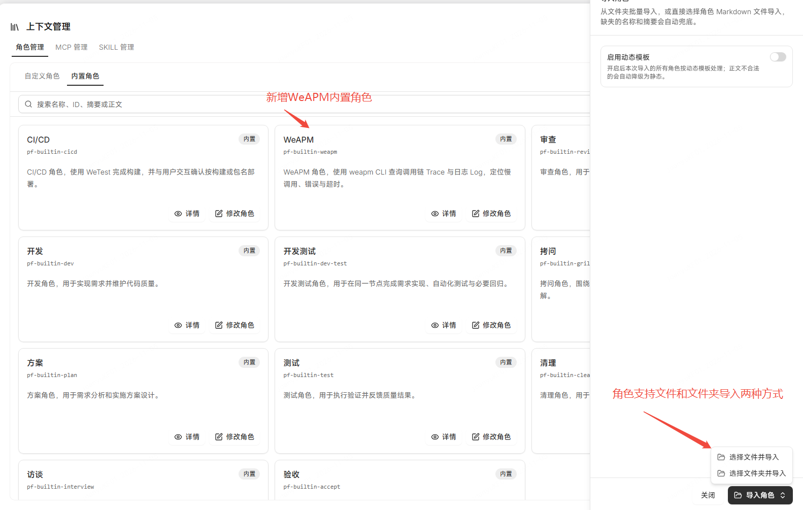

WB 渠道新增只读的 WeAPM 内置角色，可使用 WeAPM CLI 查询 Trace 和 Log，辅助定位慢调用、错误、超时和异常堆栈。

> [!NOTE]
> WeAPM 角色仅在 WB 渠道提供，需要内部 WeAPM 服务、网络环境和 `weapm` CLI；查询操作不会修改服务端数据。

### 5. IM 远程干预与 Feishu 授权体验

IM 集成设置改为按渠道独立展开的卡片，连接状态、授权、绑定和通知偏好更容易分别管理。Feishu 授权时可以选择已有应用或创建新应用，也可以在设置中切换应用；远程干预的回答会在重试、重连和迟到回调后保持一致，无法继续处理的回调会作为后续消息显示。

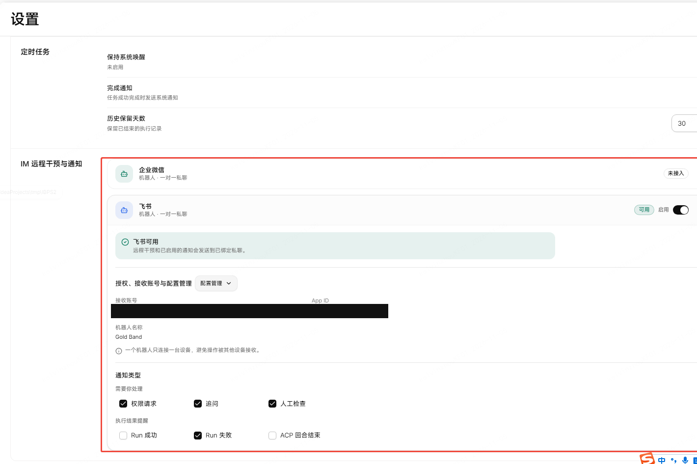

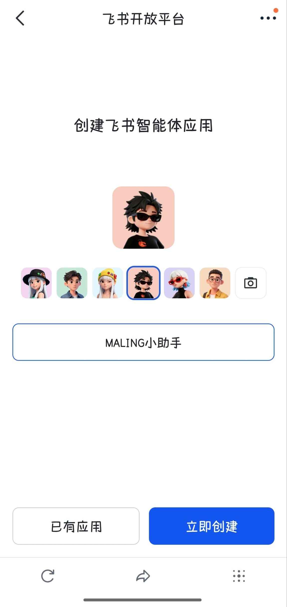

> [!WARNING]
> **更换 Feishu 应用会清除当前私聊绑定**
> 更换应用会替换当前授权并清除已有私聊绑定。完成授权后，请使用新应用对应的账号再次给机器人发送私聊消息。升级后的 IM 数据不能直接由旧版本客户端读取；如需保留降级能力，请在升级前备份应用数据。

### 6. 工作流画布与桌面显示设置

「设置 → 外观」新增「界面缩放」，支持 `50%–250%` 的整窗缩放，也可以使用 `Ctrl+滚轮`、`Ctrl+加号/减号` 和 `Ctrl+0` 调整或恢复默认值。

工作流作者态和运行态共用「自动 / 横向 / 纵向」布局方向偏好；运行图和编辑器都支持全屏查看，进入全屏后保留当前草稿和检查器，按 `Esc` 即可退出。

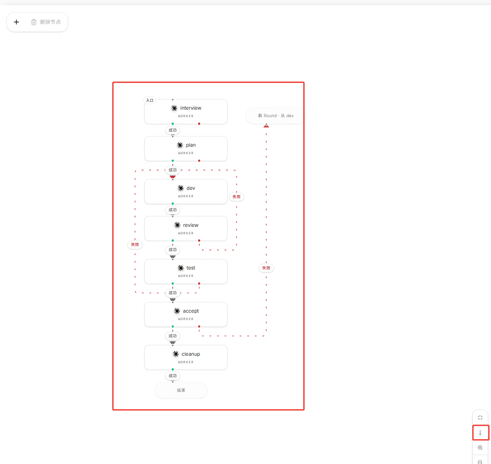

## 体验优化

### 1. 更容易找到并恢复会话

侧栏新增跨工作空间的「最近会话」区，按活动时间合并显示，点击即可直接打开对应会话；会话搜索选中尚未加载的结果时，也会补出正确的侧栏行并定位到目标。

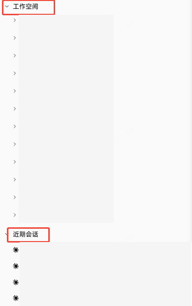

Direct 会话启动时会继续等待 ACP 真正就绪，不再在 Agent 仍在启动时误报失败；已经确认的终止错误仍会正常显示。后台刷新、分页和切换工作空间时，已显示的会话不会被迟到结果覆盖。

### 2. 文件、附件与输入状态更稳定

工作空间文件、运行产物、会话附件和 Git 文件页共享复制路径、打开所在目录、引用到对话等操作，并保留文件原始来源；草稿和队列中的附件引用也能跨页面恢复。搜索结果打开会话后，侧栏会同步展开并保持定位。

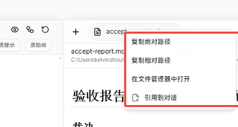

长文本输入、IM 对话滚动和右侧工作区切换更加稳定；Direct 启动、队列调度、附件预览和本地文件引用的异常会保留在对应范围内，不再扩散为整个会话或工作区的错误。

### 3. 其他稳定性改进

1. 工作流图在横向、纵向切换和全屏进出时重新适配正确的画布范围，减少连线、节点和侧栏相互遮挡。
2. 近期会话和任务列表采用有界分页与渐进加载，列表较大时不会一次读取全部历史。
3. 完善 Direct 会话恢复、待处理交互结算和远程审批状态同步，减少已处理请求重新出现或任务状态停留在旧值的情况。

---

## 0.21.1 相对于 0.21.0 的小优化

### 1. 首次引导支持稍后设置

运行环境检查通过后，Agent 检测结束或失败时可点击「稍后设置」进入主界面，再到设置中完成 Agent 配置；即使没有可用 Agent，也可以先进入应用。重启后会保留这一选择和之前的 Git 跳过设置。

### 2. 侧栏导航和近期会话更稳定

优化固定导航、工作空间、近期会话和运行记录的对齐与选中状态。近期会话支持与工作空间列表一致的展开和操作，刷新后仍保持当前分组的选中位置。列表通过「显示更多」按页加载，工作空间和近期会话列表收起后再展开时恢复首批内容。

### 3. 官网文档与下载入口更新

官网和 Demo 页面统一使用 MALING 品牌，新增知识库文档阅读页和按平台区分的下载菜单；文档切换、窄屏布局和下载入口更加稳定。
