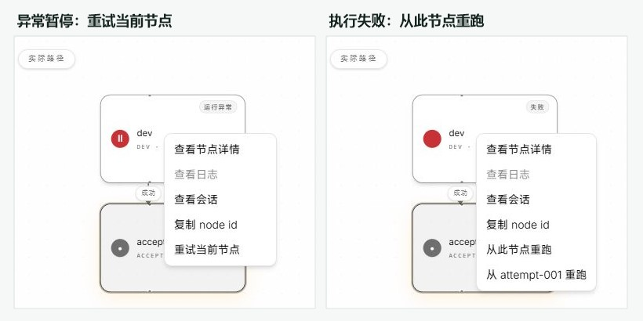
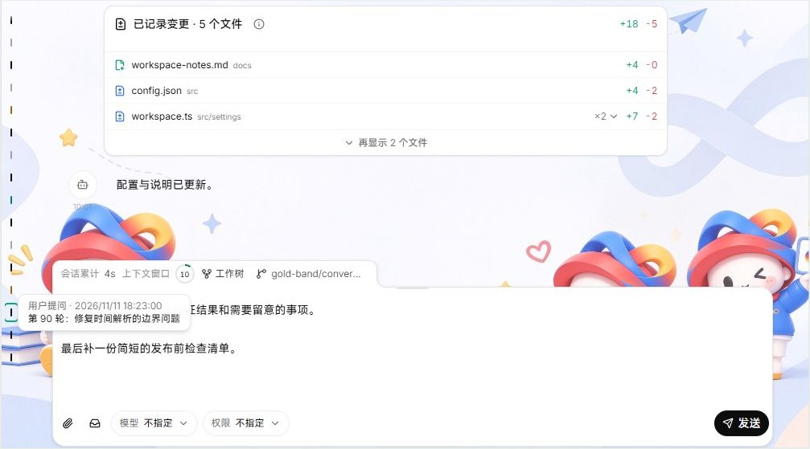

## 功能新增/调整

> [!IMPORTANT]
> 此版本会迁移本地设置。0.21.x 无法读取升级后的设置；如需保留降级能力，请在升级前备份应用数据。

### 1. 在工作流图中重试当前节点或从失败节点重跑

打开会话的工作流运行图，右键点击符合条件的节点：

1. **重试当前节点**：当前节点异常暂停、尚未推进时，在原 Run 内重新执行该节点。之前的会话和产物仍保留。
2. **从此节点重跑**：对已结束的失败记录（包括可重跑的历史记录），使用任务最新保存的工作流配置新建 Run，从选定节点开始执行。原 Run 留作只读历史。

> [!WARNING]
> 从失败节点重跑会停止来源 Run 中仍在进行的执行，但不会撤销工作区更改、Git 提交或已经发生的外部操作。这两种操作仅适用于普通工作流节点，不支持 AUTO 模式或 AI-DYNAMIC 内部节点。

### 2. 在飞书和企业微信继续或恢复工作流

完成飞书（Feishu）或企业微信（WeCom）私聊绑定后，符合条件的工作流暂停（包括在桌面端手动停止）会发送操作卡片：

1. **继续工作流**：接着执行当前尚未完成的节点。
2. **恢复工作流**：当前节点已成功、但尚未推进时，沿用已有结果推进，不再执行该节点。

默认开启通知。可在「设置 → 通用 → IM 远程干预与通知」按渠道关闭「工作流继续请求」。如果刚停止后卡片提示仍在处理，稍后可点击同一张卡片重试。

> [!NOTE]
> 远程操作需要桌面端在线。本次不支持通过 IM 启动、停止或重跑工作流，也不会批量补发升级前的历史暂停卡片。

### 3. 新增三种 Agent，首次引导更灵活

- 「Agent 管理」新增 DeepSeek Harness、ZCode 和 Qoder。ZCode 使用社区适配器；Windows ARM64 暂不提供内置 Qoder 选项。内置 CodeBuddy 的默认显示名改为 WorkBuddy，已有配置保留。
- 新增或编辑 Agent 时可查看「接入条件」，确认所需的本机命令和认证方式。
- 首次引导仍检查 Node.js、npm 和 npx，但检查失败不再拦住本机 Agent 检测。检测结果会区分未安装、缺少运行环境和诊断失败；检测结束或失败后，即使没有可用的 Agent，也可点「稍后设置」进入主界面，之后再完成配置。

### 4. 新增画境、春野主题，壁纸按明暗分别设置

在「设置 → 个性化」可切换两套新主题：

- **画境（Vista）**：浅色是水彩长卷，深色是黑金雪峰与星空；黛青和金杏的配色分别取自两幅壁纸。
- **春野（Meadow）**：浅色以比纯白更柔和的春芽绿为底，深色以松绿呈现静谧的春夜；代码和 Diff 使用更亮的底色，保持清晰。

Gold Band、画境和春野共提供 6 张内置壁纸。可为浅色和深色分别选择「主题壁纸」「自定义」或「禁用」。自定义壁纸支持「填充」「适应」，也可以从「最近使用」中删除。

### 5. 会话支持按回合定位和调整输入框高度

- 会话左侧新增回合导航：悬停预览消息，点击跳到对应回合，也能定位到尚未显示的较早回合。
- 在首页和会话页，可拖动输入框上缘调整高度。高度会跨会话保留；向下拖回较低位置可恢复自动高度。

### 6. Multica 支持卸载本机角色和工作流

连接后，可在 Multica 的「角色管理 → Runtime」同时查看当前运行环境的本机角色和工作流，并卸载非内置项。卸载只移除本机副本，不会删除 Multica 共享目录中的内容。连续提交多个资源操作时，客户端会更快处理排队请求。

## 体验优化

### 1. 侧栏和会话更易用

- 可直接在「近期会话」展开运行记录、重命名和置顶。侧栏改为点击列表末尾的按钮加载更多内容；刷新运行记录时保留当前选中位置，任务结束后及时结束转圈提示。
- Markdown 表格正文使用主题的常规文字颜色，深浅主题下都更易阅读。

### 2. 启动和 Agent 连接更稳定

- 单个 Agent 的启动配置无效时，不再影响整个应用启动。WorkBuddy 的后续对话不再因切换启动方式而断开已可用的本机连接。
- 修复部分 WebView 启动失败的问题，环境不受支持时会显示对应平台的更新指引；改进新版 MCP 客户端对内置共享记忆工具的发现。

### 3. 官网增加知识库和下载菜单

官网和 Demo 统一使用 MALING 品牌。现在可以在官网阅读知识库，并通过下载菜单按平台选择安装包。
